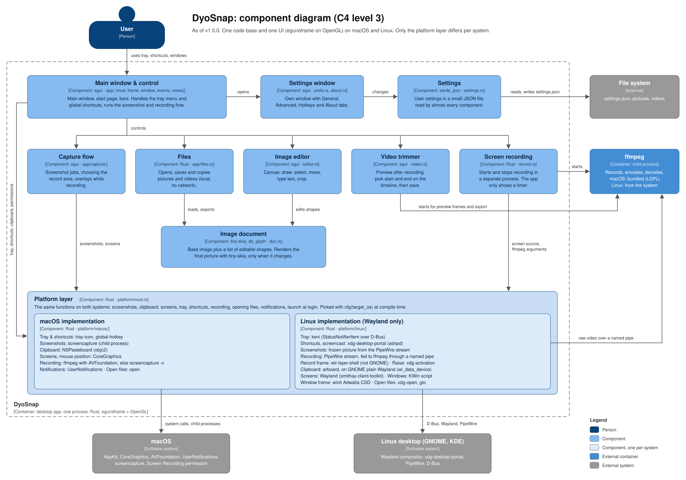

# DyoSnap

A light screenshot and screen-recording app that saves you unnecessary clicks for the macOS menu bar and Linux desktops.
Nothing is uploaded: captures are saved locally and copied to the clipboard.

**[Download the latest release](https://github.com/pschu13r/dyosnap/releases/latest)**
for macOS (Apple Silicon) and Linux (Wayland, x86_64 and arm64).

## KDE Demo


## Why DyoSnap

I am a product owner at a software company. Every day I take what feels like a million
screenshots and screen recordings: to specify tickets, answer customer requests or
explain things to colleagues. So I want a tool that creates as little extra work as
possible.

I don't want to search for the screenshot I just took. It should be in the clipboard
right away, so I can paste it into the chat. I also don't want to press Cmd+C after I
annotate it. Every change should update the clipboard, so I can paste the result
wherever it needs to go. And videos need to be crisp and small at the same time, so I
can send them without waiting.

Many tools take screenshots and record the screen. But I found none that also saves me
these clicks, keeps videos small and is free and open source. Many also get worse over time: accounts, cloud uploads,
subscriptions, ads, and more memory with every update. When my last tool started to
leak several GB of memory, I built my own.

I built DyoSnap to remove my own pain and to make my own daily work faster. My time is
valuable, and I don't want to spend it on extra clicks.

Now I have exactly the simple, lightweight tool I need every day. Maybe you will find
it useful too.

- **Fewer clicks:** every capture goes to the clipboard right away, and every edit
  updates it. No extra copy step after you annotate.
- **Pixel-exact:** while you pick an area, a crosshair and a loupe show the pixels under
  the mouse, with the size and the colour. Let go and the picture is taken.
- **Extra folders:** add up to 9 more save folders in Preferences and give each its own
  shortcut. Press it, pick an area, and the picture lands in that folder.
- **2 in 1:** take and annotate screenshots, and record your screen, in one tool.
- **Small videos:** you choose the frame rate and quality. QuickTime and other built-in
  recorders make huge files that take ages to send. DyoSnap keeps them small.
- **Fast and light:** built for speed. While it waits in the menu bar, it uses 0% CPU
  and about 100 MB of memory (M1 Pro, macOS 27).
- **Tiny download:** 6.4 MB on macOS, 15 MB installed, ffmpeg included.
- **No account, no cloud, no ads, no subscription.** DyoSnap makes no network
  connections. Your captures stay on your computer.
- **Simple:** no frills, no setup. Pick an area, annotate, done.
- **Yours to keep:** MIT license. If the project ever goes a way you don't like, fork it.

## The name

DyoSnap was called LightSnap up to v1.0.0. "LightSnap" was already used by several other
products, so I renamed it. The new name comes from the Greek δύο (*dyo*, "two"), for the
app's two jobs: screenshots and screen recordings.

They say the two classic hard problems in software are caching and naming. Caching was
no problem here. Naming all the more.

## Requirements

- **Mac:** Apple Silicon and macOS 27 or later
- **Linux:** a desktop running Wayland (see [Linux](#linux))

## Install (macOS)

The app is not notarized by Apple (that needs a paid developer account), so macOS blocks it
the first time:

1. Download `DyoSnap-<version>.zip` from
   [Releases](https://github.com/pschu13r/dyosnap/releases), unzip it and move
   `DyoSnap.app` to **Applications**.
2. Open it. macOS says it cannot check the app. Click **Done** (not "Move to Trash").
3. Go to **System Settings › Privacy & Security**, scroll down to the message about DyoSnap
   and click **Open Anyway**. Confirm with your password or Touch ID.
4. Allow **Screen & System Audio Recording** when DyoSnap asks, then quit and reopen it.

Instead of steps 2 and 3, you can remove the download mark in Terminal:

```bash
xattr -dr com.apple.quarantine /Applications/DyoSnap.app
```

To check that your copy was built by Philipp Schuler, see [Signing](#signing).

## Build (macOS)

Needs Rust (https://rustup.rs) and the Xcode command line tools. `bundle.sh` also needs
cargo-about: `cargo install --locked --features cli cargo-about`.

```bash
./scripts/build-ffmpeg.sh  # once: build the ffmpeg that ships with the app (a few minutes)
cargo run                  # run from source
./scripts/bundle.sh        # build dist/DyoSnap.app and dist/DyoSnap-<version>.zip
```

Video recording, trimming and GIF export use ffmpeg. `scripts/build-ffmpeg.sh` downloads the
official source, checks its signature and builds an LGPL-only ffmpeg (no x264) that encodes
with Apple's hardware encoder. `bundle.sh` puts it into the app. When run from source,
DyoSnap uses this build, or else an ffmpeg from Homebrew.

## Signing

Releases by Philipp Schuler are signed with a self-signed certificate:

    DyoSnap, SHA-1 9ed20208d1169d7e53a6053ee6361a894720f1bd

To check a copy, run `codesign -d -r- DyoSnap.app`. It shows the SHA-1 as
`certificate leaf = H"…"`.

To sign your own builds, see [Signing](CONTRIBUTING.md#signing-macos) in CONTRIBUTING.

## Linux

DyoSnap runs on Wayland desktops. X11 is not supported. It is tested on GNOME and KDE
Plasma.

### Install (Linux)

Download the package for your system from
[Releases](https://github.com/pschu13r/dyosnap/releases) (`x86_64`/`amd64` for most PCs,
`aarch64`/`arm64` for ARM):

- **Ubuntu, Debian:** `dyosnap_<version>-1_<arch>.deb`, then
  `sudo apt install ./dyosnap_<version>-1_<arch>.deb`. This also installs ffmpeg.
- **Fedora, openSUSE:** `dyosnap-<version>-1.<arch>.rpm`, then
  `sudo dnf install ./dyosnap-<version>-1.<arch>.rpm` (openSUSE: `sudo zypper install …`).
  See the ffmpeg note below.
- **Other distributions:** `DyoSnap-<version>-linux-<arch>.tar.gz`. Unpack it anywhere and
  start `dyosnap`. On first start it adds itself to your app list
  (`~/.local/share/applications`).

Installing the .deb or .rpm also adds the DyoSnap repository (signed with its own key), so
updates arrive with your normal system updates (`apt upgrade`, `dnf upgrade`). To opt out,
delete `/etc/apt/sources.list.d/dyosnap.sources` (Ubuntu, Debian) or
`/etc/yum.repos.d/dyosnap.repo` (Fedora).

To add the repository without downloading the package first:

```bash
# Ubuntu, Debian
sudo curl -fsSL https://dyosnap.github.io/dyosnap-archive-keyring.asc -o /usr/share/keyrings/dyosnap-archive-keyring.asc
sudo curl -fsSL https://dyosnap.github.io/dyosnap.sources -o /etc/apt/sources.list.d/dyosnap.sources
sudo apt update && sudo apt install dyosnap

# Fedora
sudo dnf config-manager addrepo --from-repofile=https://dyosnap.github.io/dyosnap.repo
sudo dnf install dyosnap
```

Switching from the tarball to the .deb or .rpm: start `dyosnap` once from a terminal. It
removes the tarball's app list entry, which would otherwise keep starting the old version.
Then delete the unpacked tarball folder.

DyoSnap also needs:

- **ffmpeg** for recordings, with x264 (preferred) or OpenH264 (fallback). To check, run
  `ffmpeg -encoders | grep -E 'libx264|libopenh264'`.
  - Ubuntu, Debian: `sudo apt install ffmpeg` (the .deb does this for you)
  - Fedora: the default `ffmpeg-free` works too. DyoSnap then records with OpenH264, which
    makes larger files (about 4 to 5 times). For smaller files, enable
    [RPM Fusion](https://rpmfusion.org/Configuration), then run
    `sudo dnf swap ffmpeg-free ffmpeg --allowerasing`.
  - Arch: `sudo pacman -S ffmpeg`
  - openSUSE: the ffmpeg from [Packman](https://en.opensuse.org/Additional_package_repositories#Packman)
- **xdg-desktop-portal** with a backend for your desktop, and **PipeWire**. Most Wayland
  desktops have both. Global shortcuts need GNOME 48+ or KDE Plasma 6.
- **On GNOME:** the AppIndicator extension for the tray icon (Ubuntu has it; on Fedora install
  "AppIndicator and KStatusNotifierItem Support"). Without a tray icon DyoSnap shows its
  window with a hint on every start.
- **Version:** `dyosnap --version` (or `-V`) prints the installed version.

### First start

Wayland lets no app read the screen or catch keys on its own, so DyoSnap asks the desktop
through its portals. Your desktop asks you once for each:

- **Screen sharing**: for screenshots and recordings. Choose all your screens (on KDE
  the tiles, or **Share full Workspace**) and keep **Remember this selection**. The desktop
  asks again when your screens change.
- **Global shortcuts**: confirm the keys. To change them later, use your desktop's settings
  (GNOME: **Settings › Apps › DyoSnap**, KDE: **System Settings › Keyboard › Shortcuts**).

### Differences between macOS and Linux desktops

|                      | macOS                          | KDE Plasma                     | GNOME                                |
|----------------------|--------------------------------|--------------------------------|--------------------------------------|
| Capture Window       | Click the highlighted window   | Click the highlighted window   | The desktop's own picker             |
| Start a recording    | Starts right away              | Starts right away              | A 3 s countdown shows the area first |
| While recording      | Red frame and control bar      | Red frame and control bar      | Tray icon only                       |
| Capture mouse clicks | Yes                            | No                             | No                                   |

Capture Area works as on macOS: the screen freezes, you drag a frame, and when you let go
the picture is taken (and copied). No button, no Enter.

- **Several screens:** the area is chosen on the screen the desktop opens DyoSnap on,
  usually the one with the mouse. A frame can't reach across two screens. Capture
  Fullscreen and Timed Capture take that whole screen.
- **Capture Window:** only KDE Plasma tells apps where windows are. Other desktops use their
  own picker. GNOME may ask once whether DyoSnap may take screenshots.
- **Recording:** DyoSnap has no window while it records. Stop or pause it with the
  shortcut, from the tray icon or, where there is one, from the control bar below the red
  frame (timer, Pause, Stop, Cancel; orange while paused). The tray icon shows a red dot
  with a ring that fills once a minute (orange while paused). The exact time is in the tray
  menu's tooltip.
- **Mouse clicks:** Wayland tells no app about clicks in other windows, so "Capture mouse
  clicks" is macOS only.

### Build from source

Ubuntu/Debian package names:

```bash
sudo apt install build-essential pkg-config clang libclang-dev libpipewire-0.3-dev \
  libspa-0.2-dev libwayland-dev libxkbcommon-dev libdbus-1-dev ffmpeg
cargo run                      # run from source
./scripts/bundle-linux.sh      # build the .tar.gz, .deb and .rpm in dist/
```

`bundle-linux.sh` also needs `cargo install --locked cargo-deb cargo-generate-rpm` and
`dpkg-dev`.

The GitHub workflow `.github/workflows/linux.yml` builds the packages for x86_64 and arm64.

## Architecture

DyoSnap is one Rust app with one UI on both systems: egui/eframe, drawn with OpenGL.
Only `src/platform/` has its own code for macOS and for Linux (tray, shortcuts, screenshots,
clipboard, recording). Video work runs in an ffmpeg child process.



`scripts/architecture-diagram.py` draws this diagram. Update it when the module layout changes.

[docs/recording.md](docs/recording.md) shows step by step how a recording runs on macOS
and on Linux, and why it works that way.

## Disclaimer

DyoSnap is a free, non-commercial hobby project under the MIT License.
It is provided "as is", without warranty of any kind. Use it at your own risk.
To the extent permitted by law, the author is not liable for any damage or loss,
including lost data, arising from the use of or inability to use this software.
There is no support and no promise of updates or fixes.

You are responsible for how you use it. Recording other people's screens,
calls or voices may require their consent where you live.

## License

MIT, see [LICENSE](LICENSE).

The app also ships ffmpeg (LGPL 2.1+) and the code of many Rust crates. Their licenses, the
ffmpeg source, its build options and our patch are listed in
[THIRD_PARTY_NOTICES.txt](THIRD_PARTY_NOTICES.txt). `scripts/notices.sh` writes that file from
`Cargo.lock` and the ffmpeg build; `bundle.sh` runs it and copies it, `LICENSE`, the patch and
the ffmpeg build script into `DyoSnap.app/Contents/Resources/`.

On Linux, ffmpeg is not shipped. `scripts/bundle-linux.sh` writes the crate licenses for the
Linux build into the package as `THIRD_PARTY_NOTICES.txt`.
