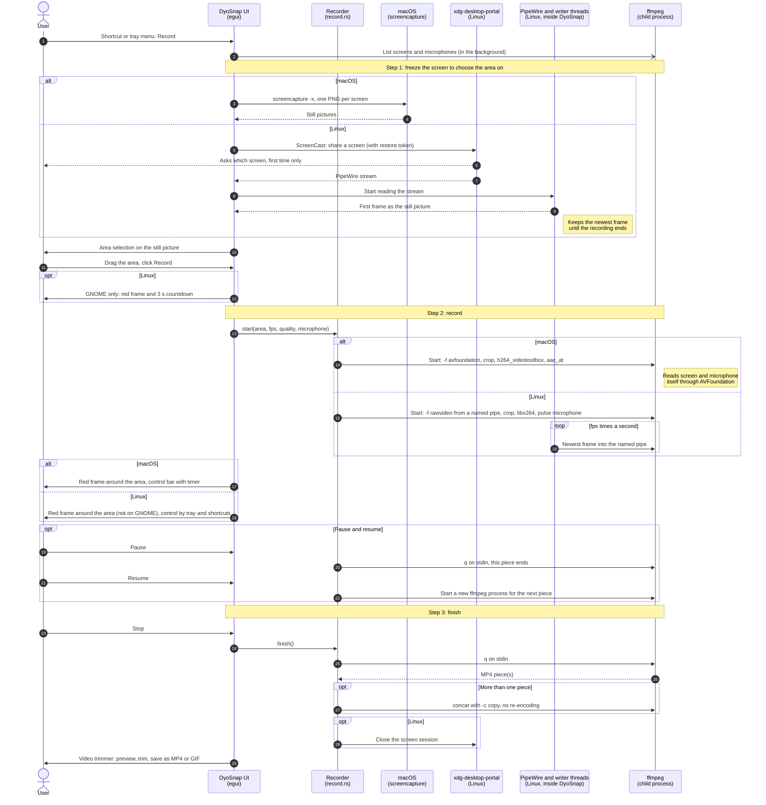

# Screen recording on macOS and Linux

How a recording runs, from the shortcut to the video trimmer. Both systems share the UI,
the recorder and ffmpeg as the encoder. They differ in how DyoSnap gets at the screen:
on macOS ffmpeg reads it itself, on Linux (Wayland) DyoSnap gets it from the desktop and
hands it to ffmpeg.

See [README: Architecture](../README.md#architecture) for the component diagram.

Without ffmpeg, macOS records with its own `screencapture -v` (no pause, no frame rate or
quality settings). Linux cannot record without ffmpeg.

## Why it works this way

**Both systems**

- **ffmpeg runs as its own process.** The app only shows a timer and stays small and idle.
  ffmpeg is called as a separate program and not linked, so DyoSnap can stay MIT.
- **One encode path.** ffmpeg crops and encodes on both systems, so the recorder code is the
  same. Only the input and the encoder names differ.
- **Stop with `q` on stdin.** ffmpeg then stops cleanly and finishes the MP4 file. After 8 s
  without an exit, the recorder kills it.
- **Pause makes pieces.** ffmpeg cannot pause a recording. Each pause ends the process and
  resume starts a new one. At the end the pieces are joined without re-encoding. Each piece
  loses about half a second to ffmpeg's startup.
- **The area is chosen on a still picture.** The selection works across several screens,
  and the area can be dragged to another screen.
- **ffmpeg's error output goes to a log file.** A full pipe could stall a long recording.
- **Frame rate and quality are settings.** Built-in recorders make huge files that take
  ages to send. DyoSnap keeps them small.

**macOS**

- **ffmpeg reads the screen through AVFoundation.** It is ffmpeg's screen and microphone
  input on macOS. The cursor and clicks come from AVFoundation too.
- **DyoSnap ships its own ffmpeg, built under the LGPL.** Ready-made macOS builds almost
  always contain x264 and are GPL. The own build has only what DyoSnap needs: AVFoundation
  input, Apple's hardware H.264 encoder and Apple's AAC encoder. That keeps it small.
- **A patch fixes lost sound.** ffmpeg's AVFoundation input keeps only one audio frame.
  While a video frame is read, newer audio overwrites older audio, so recordings lost about
  15 % of their sound. The patch queues the audio frames instead.
- **The red frame is four thin windows outside the area.** One see-through window over the
  area would be recorded as black.

**Linux (Wayland only)**

- **Wayland only, no X11.** X11 is de facto replaced: Ubuntu, Fedora and KDE use Wayland by
  default. Supporting X11 too would double the platform code for a shrinking share of desktops.
- **Screen access goes through the ScreenCast portal.** Wayland lets no app read the screen.
  The portal asks the person once; the restore token remembers the answer. DyoSnap asks
  for all screens: GNOME gives one stream per screen, KDE one per screen or, with "full
  workspace", one stream of the whole desktop without a position. Each screen is cut out of
  the stream that shows it (`locate` in `recording.rs`).
- **DyoSnap reads PipeWire itself.** The ffmpeg in current Ubuntu cannot read PipeWire.
- **Frames go to ffmpeg through a named pipe, at a steady rate.** The compositor sends a
  frame only when the screen changes. The writer repeats the newest frame `fps` times a
  second, so the video has an even frame rate.
- **The screens stay shared from the still pictures to the end of the recording.** The
  person picks them once, and the recording starts at once. When the recording starts,
  the streams that don't show its screen stop (`keep_only_screen`): each running stream
  costs a copy of every frame.
- **The area is chosen in the full-screen main window.** Wayland can neither place windows
  nor reliably put a new one in front, and it tells no app where the mouse is. The window
  goes full screen where the compositor opens it (usually the screen with the mouse) and
  shows that screen's picture. Only if that screen was not shared, DyoSnap moves it to a
  shared one. A frame can't reach across screens on Linux. For the same
  reason there is no control bar while recording: the tray and the shortcuts control it.
  Where no red frame can be drawn (GNOME), a 3 s countdown shows the area first.
- **Area screenshots use the same selection.** The screen's frozen picture, without
  the mouse pointer; the picture is taken when the mouse is let go, as with
  `screencapture -i` on macOS. The desktop's own pickers ask for an extra click (GNOME) or
  offer no area at all (KDE). The screen is shared only while choosing. Full-screen and
  timed captures open the same window and take the whole screen at once, undimmed, as soon
  as the window has the keyboard focus: on GNOME only a focused window can set the
  clipboard without XWayland (`wl_clipboard.rs`). The shortcut portal's activation token
  is handed to the window (`XDG_ACTIVATION_TOKEN`), so GNOME gives it the focus. A window
  that is already open gets the token of a tray click or shortcut through xdg-activation-v1
  (`activate.rs`). KDE's shortcut portal sends no token; there a KWin script puts the
  window in front instead (`windows.rs`).
- **Capture Window on KDE uses the same selection.** A KWin script lists the windows
  (`windows.rs`, through org.kde.kwin.Scripting, open to every app) before the picture is
  taken; the window under the mouse is highlighted and a click takes it, with its title
  bar. Parts of other windows on top of it are in the picture, unlike macOS. Other
  desktops have no such list and keep their own picker.
- **The clipboard on GNOME goes through plain Wayland.** GNOME has no data-control
  protocol, so copying (pictures, text, file references) and reading ("Open from
  Clipboard") need DyoSnap's focus; reading waits for the window to get it.
- **The control bar is one more layer surface, below the area.** Same place, buttons and
  colors as on macOS, drawn with tiny-skia and ab_glyph; it takes clicks (the frame
  doesn't) and hands them to the app (`RecFrame::take_action`). GNOME has none: the tray
  and the shortcuts control the recording there.
- **No mouse clicks in the video on Linux.** Wayland tells no app about clicks in other
  apps' windows; the ScreenCast portal gives the pointer, not its buttons.
- **The red frame is four layer surfaces outside the area.** The wlr-layer-shell protocol
  lets a surface sit at a fixed place above all windows, without taking clicks or keys.
  KDE Plasma, Sway, Hyprland and COSMIC support it. GNOME does not, and gets no frame:
  only a Shell extension or X11 could draw one there, and both are not worth it. The
  recording is cropped to the area, so the frame is not in the video.
- **ffmpeg comes from the system.** DyoSnap does not ship it on Linux, so encoding with
  libx264 is fine. Microphones come from PulseAudio or PipeWire's Pulse server.
